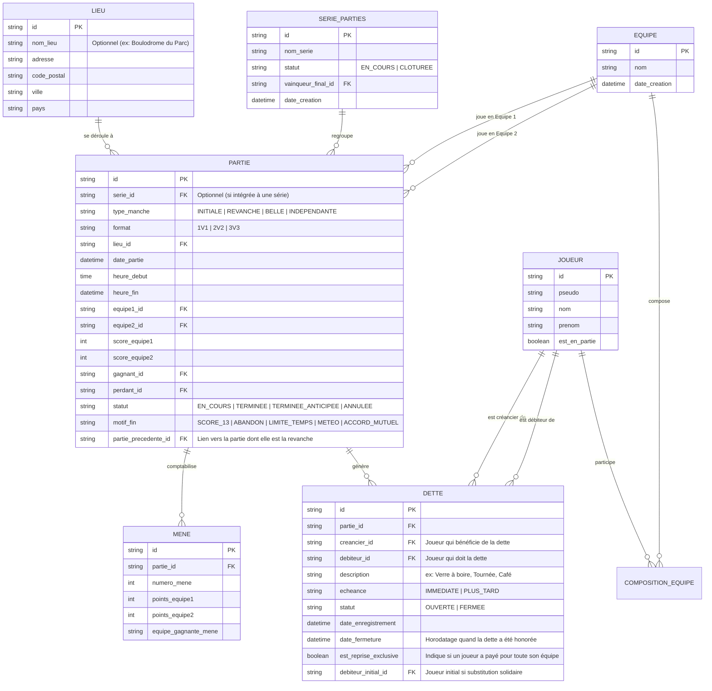

# Spécifications Fonctionnelles & Techniques — Application `parties`

## 1. Présentation Générale

L'application **`parties`** est une solution logicielle dédiée à la gestion, au suivi du score, à la traçabilité et aux traditions conviviales du jeu de **pétanque**.
Elle permet d'organiser des **parties libres** et des séries de duels (Revanche, La Belle) entre deux équipes, tout en gérant la géolocalisation, les engagements (dettes/gages individuels ou d'équipe), la non-simultanéité des joueurs et l'historique complet des résultats.

---

## 2. Périmètre Fonctionnel

### 2.1 Gestion des Équipes et Joueurs
- **Création et composition des équipes** : Configuration des deux équipes adverses (nom d'équipe, couleur d'identification).
- **Règle stricte de parité des effectifs** : Lors d'une confrontation, les deux équipes doivent obligatoirement être composées du **même nombre de joueurs** ($N_1 = N_2$).
- **Contrainte d'unicité et de non-simultanéité** :
  - **Un joueur ne peut pas participer à 2 parties en parallèle.**
  - Si un joueur est déjà engagé dans une partie au statut `EN_COURS`, l'application bloque son inscription ou le démarrage d'une nouvelle partie tant que sa partie précédente n'est pas clôturée.

### 2.2 Formats de Jeu Autorisés & Nombre de Boules en Main
L'application prend en charge les trois formats traditionnels et officiels de la pétanque :
1. **Tête-à-tête (1 contre 1)** : 1 joueur par équipe, 3 boules par joueur $\rightarrow$ **3 boules au total par équipe**.
2. **Doublette (2 contre 2)** : 2 joueurs par équipe, 3 boules par joueur $\rightarrow$ **6 boules au total par équipe**.
3. **Triplette (3 contre 3)** : 3 joueurs par équipe, 2 boules par joueur $\rightarrow$ **6 boules au total par équipe**.

---

### 2.3 Localisation et Temporalité Obligatoires
Chaque partie est rigoureusement contextualisée dans le temps et dans l'espace. Les champs suivants sont **strictement obligatoires** à l'initialisation :
- **Temporalité** :
  - **Date** de la partie.
  - **Heure de début** (horodatage précis du coup d'envoi).
  - **Heure de fin** (enregistrée automatiquement lors de la clôture nominale ou anticipée).
- **Lieu de la partie** :
  - **Adresse** (numéro et voie / nom du boulodrome ou terrain).
  - **Code postal**.
  - **Ville**.
  - **Pays**.

---

### 2.4 Enjeu, Dettes et Gages de Convivialité (« Le Carnet de Dettes »)

Fidèle à la tradition de la pétanque, la partie permet de formaliser un enjeu amical (ex: un verre à boire, une tournée, un café, etc.) qui donne lieu à une ou plusieurs **dettes**.

#### A. Nature Individuelle de la Dette
- **Principe général** : La dette est **individuelle**, quel que soit le format de jeu (Tête-à-tête, Doublette ou Triplette).
- Chaque dette relie précisément deux personnes :
  - **Le Créancier** : La personne (joueur) à qui la dette est due (généralement un membre de l'équipe gagnante).
  - **Le Débiteur** : La personne (joueur) qui doit la dette (généralement un membre de l'équipe perdante).
- *Exemple en Triplette (3 vs 3)* : Par défaut, la partie génère 3 dettes individuelles (chacun des 3 perdants doit un verre à l'un des 3 gagnants).

#### B. Prise en Charge Exclusive par un Coéquipier (« Régaler l'équipe »)
- **Règle de solidarité** : Un joueur de l'équipe peut décider volontairement de **prendre la dette pour lui tout seul** (assumer l'intégralité des dettes dues par son équipe).
- **Enregistrement dans l'application** :
  - L'application consigne formellement cette prise en charge : ce joueur devient le **débiteur unique** de toutes les dettes générées par la partie.
  - L'application garde en mémoire l'historique de cette décision avec un indicateur dédié (`est_reprise_exclusive: true`), mentionnant que ce joueur a régalé et déchargé ses coéquipiers.

#### C. Statut et Suivi de la Dette : « Ouverte » vs « Fermée »
L'application permet de savoir à tout moment si une dette a été honorée :
- **Dette OUVERTE** : La dette a été contractée mais n'a pas encore été honorée/payée.
- **Dette FERMÉE** : La dette a été honorée par le débiteur envers le créancier.
- **Modalité de consommation** :
  - **À consommer tout de suite** : Peut être clôturée immédiatement à la fin de la partie (passage immédiat à `FERMÉE`).
  - **À consommer plus tard** : Reste au statut `OUVERTE` dans le carnet de dettes des deux joueurs jusqu'à son règlement ultérieur dans l'application.

#### D. Données Obligatoires d'une Dette
Chaque dette enregistre de manière immuable :
- La **date d'enregistrement** de la dette.
- L'identité précise du **Créancier** (Joueur).
- L'identité précise du **Débiteur** (Joueur).
- La nature de la dette (ex: *« Verre à boire »*).
- L'échéance convenue (*Tout de suite* / *Plus tard*).
- Le statut courant : **`OUVERTE`** ou **`FERMÉE`**.
- La **date et heure de fermeture / acquittement** (dès qu'elle est honorée).
- La mention de prise en charge solitaire le cas échéant.

---

### 2.5 Déroulement, Points par Mène et Clôture de Partie

#### A. Décompte des Points par Mène (Jusqu'à 6 points)
- À chaque mène jouée, une seule équipe marque des points (celle dont la boule la plus proche est plus proche du bouchon que la meilleure boule adverse).
- **Capacité de points par mène** : Une équipe marque autant de points qu'elle a de boules mieux placées que la meilleure boule adverse.
  - En **Tête-à-tête (1 vs 1)** : L'équipe a 3 boules en main $\rightarrow$ gain possible de **1 à 3 points**.
  - En **Doublette (2 vs 2)** : L'équipe a 6 boules en main (2 joueurs $\times$ 3 boules) $\rightarrow$ gain possible de **1 à 6 points** si toutes les boules en main comptent.
  - En **Triplette (3 vs 3)** : L'équipe a 6 boules en main (3 joueurs $\times$ 2 boules) $\rightarrow$ gain possible de **1 à 6 points** si toutes les boules en main comptent.
- **Exigence d'interface absolue** : L'écran de saisie du score d'une mène **ne doit en aucun cas être restreint à 4 points**. Il doit proposer des sélecteurs allant de **1 à 6 points** (de 1 à 6 boutons de points directement accessibles).

#### B. Règle Nominale de Victoire (13 points)
- Une partie classique se dispute en **13 points gagnants**.
- Dès qu'une équipe atteint ou dépasse 13 points à l'issue d'une mène, la partie se termine automatiquement.
- L'application désigne formellement le **Gagnant** et le **Perdant**.

#### C. Clôture Anticipée (< 13 points)
- Une partie peut être arrêtée avant que l'une des équipes n'atteigne 13 points.
- Motifs pris en compte : Abandon/Forfait, Limite de temps, Météo/Obscurité, Accord mutuel.
- L'état exact du score est sauvegardé avec l'heure exacte de clôture. Le gagnant est désigné sur la base du score au moment de l'arrêt (ou par forfait).

#### D. Données Mémorisées à la Fin de la Partie
À la fin de la partie, l'application fige et historise obligatoirement :
- L'équipe gagnante et ses joueurs.
- L'équipe perdante et ses joueurs.
- Le score final exact de chaque équipe.
- La date, l'heure de début et l'heure exacte de fin.
- Le lieu complet (adresse, code postal, ville, pays).
- Les dettes créées (créancier, débiteur, statut ouverte/fermée, date).
- L'appartenance éventuelle à une série de duels (Revanche / La Belle).

---

### 2.6 Enchaînement de Parties : « Revanche » et « La Belle »

L'application gère nativement le cycle traditionnel de duel en série :
1. **Proposition de Revanche Immédiate** :
   - Dès la clôture d'une partie (Partie 1), l'application propose immédiatement au perdant de lancer une **Revanche** (Partie 2).
   - Les compositions d'équipes et le lieu sont conservés par défaut pour un lancement instantané.
2. **« La Belle » (Manche décisive)** :
   - Si l'équipe qui a perdu la première partie remporte la revanche, le score de la série est de **1 manche partout (1 - 1)**.
   - L'application propose alors de lancer une 3ème manche décisive appelée **« La Belle »**.
   - Cette 3ème partie détermine le **Vainqueur Final** de la série.
3. **Mémorisation de l'Enchaînement** :
   - L'application regroupe ces parties sous une même entité logique de **Série / Duel**.
   - Elle mémorise la filiation : `Partie Initiale` ➔ `Revanche` ➔ `La Belle`.
   - L'historique permet de consulter la série dans son ensemble (score global des manches, cumul des points, cumul et bilan des dettes).

---

## 3. Matrice des Règles Métier (Business Rules)

| Code | Règle Métier | Description | Priorité |
|---|---|---|---|
| **BR-01** | **Parité des effectifs** | L'effectif de l'Équipe 1 doit être strictement égal à celui de l'Équipe 2 ($N_1 = N_2$). | Bloquante |
| **BR-02** | **Formats stricts** | Les seules valeurs autorisées pour $N$ sont **1 (Tête-à-tête)**, **2 (Doublette)** ou **3 (Triplette)**. | Bloquante |
| **BR-03** | **Non-simultanéité joueur** | Un joueur participant à une partie avec statut `EN_COURS` ne peut pas être ajouté à une autre partie simultanément. | Bloquante |
| **BR-04** | **Complétude temporelle et géographique** | Date, Heure de début, Adresse, Code Postal, Ville et Pays sont strictement obligatoires pour démarrer une partie. | Bloquante |
| **BR-05** | **Score maximal par mène (jusqu'à 6 points)** | Une équipe peut marquer de **1 à 6 points** par mène pour l'ensemble des boules en main au départ (jusqu'à 3 en 1v1, jusqu'à 6 en 2v2 et 3v3). L'interface doit obligatoirement proposer les options de 1 à 6 points. | Bloquante |
| **BR-06** | **Victoire nominale à 13 pts** | Dès qu'une équipe atteint **13 points**, la partie se clôture immédiatement avec statut `TERMINEE_13_PTS`. | Automatique |
| **BR-07** | **Arrêt prématuré** | Une partie peut être stoppée à un score `< 13`. L'heure de fin, le score arrêté et le motif sont archivés. | Majeure |
| **BR-08** | **Désignation Gagnant / Perdant** | Toute partie terminée identifie sans ambiguïté 1 Équipe Gagnante et 1 Équipe Perdante (avec archivage de l'heure de fin). | Obligatoire |
| **BR-09** | **Dette nominative individuelle** | La dette est nominative et individuelle entre un **Débiteur** (joueur) et un **Créancier** (joueur), enregistrée avec sa date. | Obligatoire |
| **BR-10** | **Statut Ouverte / Fermée** | Une dette est créée avec le statut **`OUVERTE`**. L'application permet de la marquer comme honorée, passant son statut à **`FERMÉE`** avec horodatage de fermeture. | Obligatoire |
| **BR-11** | **Prise en charge exclusive de dette** | Un joueur de l'équipe perdante peut assumer seul la totalité des dettes de l'équipe. L'application consigne explicitement ce fait. | Majeure |
| **BR-12** | **Enchaînement Revanche** | À la fin d'une partie, une Revanche peut être générée immédiatement en liant la nouvelle partie à la précédente. | Majeure |
| **BR-13** | **Déclenchement de La Belle** | Si le score de la série est de 1 manche partout après la Revanche, une 3ème partie « La Belle » est autorisée pour départager les équipes. | Majeure |

---

## 4. Modèle Conceptuel de Données (MCD)

---

## 5. Parcours Utilisateur & Expérience (UX)

### Écran 1 : Initialisation de la Partie Libre
1. **Localisation obligatoire** :
   - Saisie ou géolocalisation automatique : Adresse, Code postal, Ville, Pays (avec mémoire des lieux favoris).
2. **Format & Équipes** :
   - Sélection : Tête-à-tête (1v1 - 3 boules/équipe), Doublette (2v2 - 6 boules/équipe) ou Triplette (3v3 - 6 boules/équipe).
   - Sélection des joueurs avec **contrôle d'indisponibilité** (alerte bloquante si un joueur est déjà dans une partie active).
3. **Paramétrage de l'Enjeu (La Dette)** :
   - Choix : *Verre à boire*, *Tournée*, *Gage libre*, ou *Sans enjeu*.
   - Échéance : *Tout de suite* ou *Plus tard*.
4. **Action** : Horodatage automatique de l'heure de début et clic sur **« Lancer la partie »**.

### Écran 2 : Tableau de Score en Temps Réel
- Affichage du format, du lieu et de l'enjeu fixé.
- Scoreboard dynamique mène par mène.
- **Saisie des points de la mène** :
  - Sélection de l'équipe gagnante de la mène (Équipe A ou Équipe B).
  - **Sélecteur de points de 1 à 6** : Boutons tactiles `[ 1 ]` `[ 2 ]` `[ 3 ]` `[ 4 ]` `[ 5 ]` `[ 6 ]` permettant d'enregistrer la totalité des boules ayant marqué (notamment les 6 boules en main en Doublette et Triplette).
- Protection d'intégrité : Joueurs engagés marqués comme indisponibles pour d'autres parties.
- Bouton de clôture anticipée avec saisie de motif en cas d'arrêt avant 13 points.

### Écran 3 : Clôture, Proclamation & Répartition des Dettes
- Horodatage immédiat de l'heure de fin.
- Proclamation officielle du **Gagnant** et du **Perdant** avec le score final.
- **Gestion des Dettes de la partie** :
  - Liste nominative des dettes générées (par défaut individuelle : chaque perdant doit à un gagnant).
  - Option solidaire d'équipe : Case à cocher **« [Nom du joueur] prend toute la dette pour l'équipe »**.
    - *Si activée* : Toutes les dettes sont assignées à ce joueur comme unique débiteur, avec mention spéciale dans l'application.
  - Action immédiate :
    - Bouton **« Marquer comme honorée maintenant (Fermée) »** si consommée sur-le-champ.
    - Sinon, enregistrement avec le statut **`OUVERTE`** pour règlement futur.
- **Bloc Revanche** :
  - Bouton : **« Proposer la revanche au perdant »** (Initialisation de la Manche 2 en conservant les équipes et le lieu).

### Écran 4 : Gestion de Série (Revanche & La Belle)
- Si l'équipe battue en Manche 1 gagne la Revanche :
  - L'écran affiche l'égalité : **1 manche à 1**.
  - L'application propose automatiquement le bouton : **« Lancer La Belle (Manche Décisive) »**.
- Clôture de La Belle :
  - Proclamation du **Vainqueur Final de la Série**.
  - Historique complet des 3 manches consécutives avec leurs scores, durées et cumul des dettes (ouvertes et fermées).

### Écran 5 : Espace « Carnet de Dettes » (Consultation & Règlement)
- Accessible depuis le menu principal ou le profil joueur :
  - **Onglet « Dettes à payer » (Débiteur)** : Liste des dettes ouvertes dues par le joueur (vers qui, quelle partie, quelle date).
  - **Onglet « Dettes à recevoir » (Créancier)** : Liste des verres / gages dus au joueur.
  - **Historique « Dettes honorées » (Fermées)** : Archive avec date à laquelle chaque dette a été fermée.
  - Bouton d'action rapide : **« Marquer comme honorée »** (fait passer la dette de `OUVERTE` à `FERMÉE` avec horodatage).

---

## 6. Synthèse des Données Mémorisées par l'Application

L'application conserve en base persistante pour chaque partie :
- ✅ **Date et heures précises** (Début et Fin horodatés).
- ✅ **Lieu complet** (Adresse, Code Postal, Ville, Pays).
- ✅ **Format et joueurs** (avec contrôle strict d'absence de parties simultanées).
- ✅ **Points par mène complets** : Saisie libre de 1 à 6 points par mène.
- ✅ **Résultat certifié** : Identité du Gagnant, identité du Perdant, score final.
- ✅ **Dettes nominatives complètes** :
  - Date d'enregistrement et date de fermeture.
  - Débiteur précis et Créancier précis (joueurs individuels).
  - Statut : **`OUVERTE`** ou **`FERMÉE`** (savoir si elle a été honorée).
  - Traçabilité de la **prise en charge pour soi tout seul** par un coéquipier.
- ✅ **Lien de série** : Filiation Revanche / La Belle avec désignation du vainqueur final de la confrontation.
